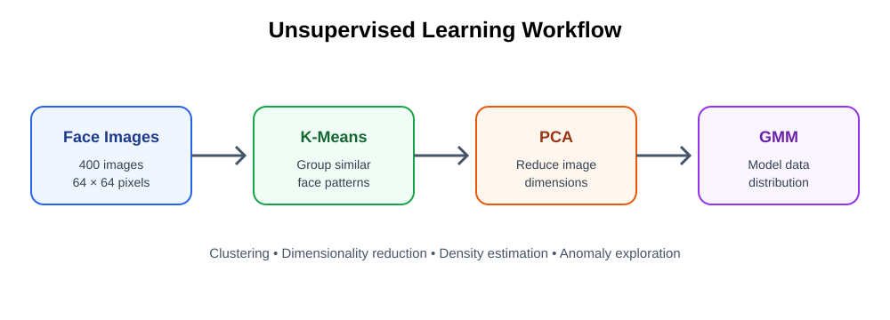
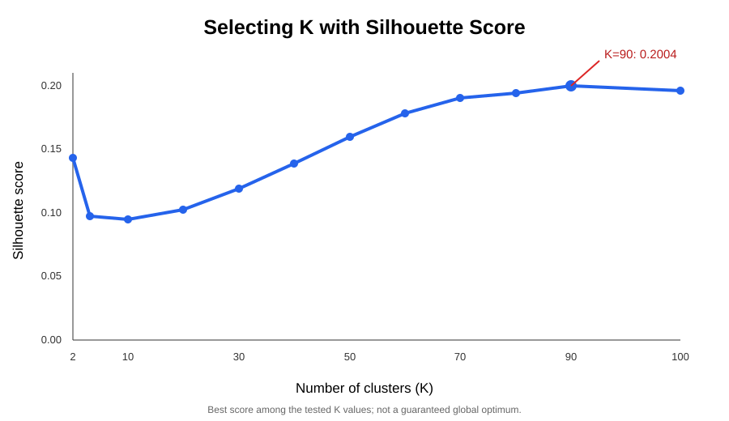
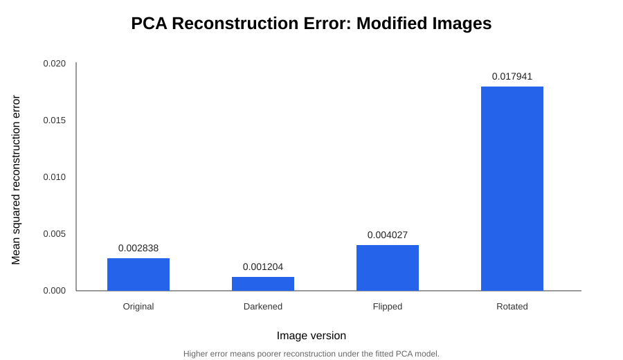

# Unsupervised Learning with the Olivetti Faces Dataset

A beginner-friendly, hands-on machine learning project exploring how unsupervised learning techniques can uncover structure in data, reduce its dimensionality, model distributions, and identify unusual samples.

This project is part of my AI/ML learning journey, inspired by *Hands-On Machine Learning with Scikit-Learn, Keras, and TensorFlow (3rd Edition)* by Aurélien Géron.

## Project workflow



## Project goals

- Explore clustering with **K-Means**.
- Evaluate clusters using **Silhouette Score** and **Adjusted Rand Index (ARI)**.
- Compare a baseline classifier with K-Means-derived features.
- Reduce image dimensions using **Principal Component Analysis (PCA)**.
- Fit a **Gaussian Mixture Model (GMM)** and generate synthetic face-like samples.
- Explore anomaly detection using GMM log-likelihood and PCA reconstruction error.

## Dataset

The project uses the **Olivetti Faces** dataset available through scikit-learn.

- 400 grayscale face images
- 40 people (10 images per person)
- Each image is 64 × 64 pixels
- Each image is represented as 4,096 numerical pixel features

The dataset is loaded programmatically; the raw dataset is not committed to this repository.

## Methods and experiments

### 1. K-Means clustering

K-Means was evaluated with several cluster counts using silhouette score. Among the tested values, **K = 90** produced the highest silhouette score (**0.2004**). This is the best value among the values tested, not a claim of a globally optimal number of clusters.



The cluster labels are algorithm-generated group IDs; they are not the original person identities.

### 2. Classification with K-Means features

Logistic Regression was used as a supervised baseline and compared with models using K-Means distance features.

| Feature setup | Validation accuracy |
|---|---:|
| Original 4,096 pixel features | 95.00% |
| K-Means distance features (K = 90) | 93.75% |
| Original + K-Means distance features (K = 20) | 96.25% |

The combined feature setup improved validation accuracy by one correctly classified image compared with the baseline (77/80 versus 76/80). This is a small difference on a small validation set and should not be interpreted as proof of a robust improvement.

### 3. PCA dimensionality reduction

PCA retained approximately **99.02% of the variance** while reducing the representation from **4,096 features to 177 principal components**.

### 4. Gaussian Mixture Model and anomaly detection

A GMM with 40 components was fitted to the PCA-reduced training data. Synthetic samples were generated and transformed back into the original pixel space for visualization.

GMM `score_samples()` was used to compare how likely validation images were under the learned distribution. Lower (more negative) log-likelihood scores indicate samples that are less likely under the fitted model; they are not calibrated fraud or anomaly probabilities.

### 5. PCA reconstruction error

Validation images were reconstructed from their PCA representation. Mean squared reconstruction error was used to measure the difference between each original image and its reconstruction.

The experiments showed that different anomaly-detection approaches can respond differently to modified images. For example, the darkened image had a lower PCA reconstruction error than the original, even though its GMM likelihood was much lower. These methods can flag unusual patterns, but neither score alone proves that an image is anomalous.



## Train, validation, and test split

The 400 images were split using stratification:

- Training: 240 images
- Validation: 80 images
- Test: 80 images

The validation set was used for model comparison. The test set should remain untouched until final model selection and evaluation.

## Tools and libraries

- Python
- NumPy
- Matplotlib
- scikit-learn
- Jupyter Notebook

## Repository structure

```text
unsupervised-learning-olivetti-faces/
├── README.md
├── LICENSE
├── .gitignore
├── olivetti_faces_unsupervised_learning.ipynb
├── requirements.txt
└── images/
    ├── README.md
    ├── cluster-selection.svg
    ├── pca-reconstruction-error.svg
    └── unsupervised-learning-workflow.svg
```

## How to run

1. Clone this repository.
2. Install the dependencies listed in `requirements.txt`.
3. Open `olivetti_faces_unsupervised_learning.ipynb` in Jupyter.
4. Run the cells from top to bottom. The notebook will fetch the Olivetti Faces dataset through scikit-learn.

## Key learning

This project helped me understand that unsupervised learning is not only about grouping data. It can also help represent complex data in fewer dimensions, model patterns probabilistically, and surface samples that differ from what a model has learned.

The experiments also highlight an important lesson: **different methods measure different kinds of unusualness, and results must be interpreted in context.**

## Acknowledgements

- Aurélien Géron, *Hands-On Machine Learning with Scikit-Learn, Keras, and TensorFlow (3rd Edition)*.
- The Olivetti Faces dataset, accessed through scikit-learn.

---

*This is an educational learning project. Results are specific to the chosen data split, model settings, and experiments.*
